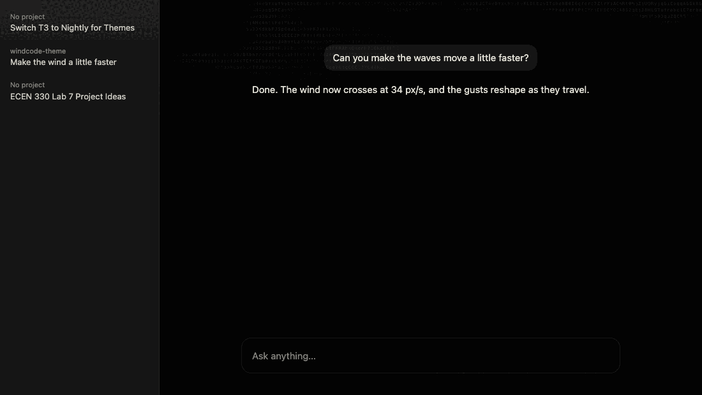

# windcode-theme

Animated chat backgrounds for [T3 Code](https://github.com/pingdotgg/t3code): a grid of small letters, faint everywhere, lit where gusts of wind drift across it, with letters quietly changing in place. After Claude Code's "New session" texture.

## Themes

| Theme | Look |
|---|---|
| [Wind](themes/wind.json) | Grey letters on black. Closest to the Claude Code look. |
| [Archive Wind](themes/archive-wind.json) | Greek, Hebrew and Latin letters. |
| [Tide](themes/tide.json) | Blue code characters in long rolling swells. |
| [Paper Wind](themes/paper-wind.json) | Light mode: ink letters on paper. |

Each one also gives the sidebar a plain glass tint.

## Install

1. Download a theme's `.json` (open it above, then **Download raw file**), or [all of them as a zip](https://github.com/Noah-Airmet/windcode-theme/archive/refs/heads/main.zip).
2. In T3 Code: **Settings → Appearance → Add theme**, and drop the file in.
3. Pick the theme.

Needs a T3 Code build with custom themes (the Nightly track has them). Motion stops when macOS Reduce Motion is on.

From a terminal instead: `t3 theme set wind.json --id wind`.

## How it works

T3 themes are CSS only, with no scripts and at most 20,000 characters, so nothing is simulated live:

- The letters are a small SVG tile, repeated.
- The gust field (warped value noise with thin threads along the wind) is computed once into a small PNG that tiles seamlessly.
- The page animates mask positions. The wind drifts at 34 px/s; two copies of the field at different sizes and speeds intersect, so gusts swell and break up as they travel; a sparse mask of cells jumps every 0.4 s to swap letters in place.

The animation has to live in the page's CSS. An animated SVG used as a background image shows as a still picture.

`wind.py` builds the themes (`./wind.py`, needs [uv](https://docs.astral.sh/uv/)). Speeds, sizes, colours and letter sets are at the top.

## Credits

Inspired by Claude Code's "New session" background. None of Anthropic's code is in it.

MIT licensed.
